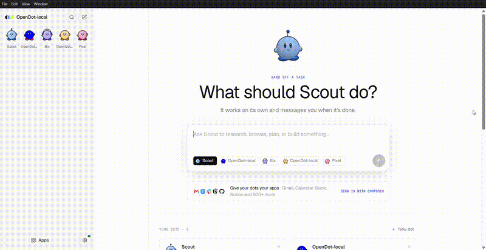

# OpenDot-local

A local-first, privacy-respecting personal AI desktop agent that runs on your computer using Ollama.

🌐 **Website & Documentation**: [https://opendot-local.vercel.app/](https://opendot-local.vercel.app/)

---

## 🎬 Demo

<p align="center">
  
</p>

---

## 📥 Download

Prebuilt installers are attached to every tagged release:

- **Windows Installer**: [Download latest `.exe` from GitHub Releases](https://github.com/VedantJadhav701/opendot-local/releases)
- **macOS Installer (Experimental)**: [Download latest `.dmg` from GitHub Releases](https://github.com/VedantJadhav701/opendot-local/releases)

> [!NOTE]
> Because Windows installers are currently community-built and unsigned, Windows Defender SmartScreen may display an "unrecognized app" warning. Click **More info**, then **Run anyway**. Free open-source code signing is planned. On macOS, right-click the app and choose **Open**.

---

## 💻 Requirements

- **Operating System**: Windows 10/11 (64-bit), macOS 12+ (Apple Silicon or Intel), or Linux
- **Memory**: 8 GB RAM minimum (16 GB+ recommended for 7B+ models)
- **Ollama**: Installed and running locally ([ollama.com/download](https://ollama.com/download))
- **Node.js**: v22.5.0 or higher (for building from source)

---

## ⚡ 3-Step Quick Start

1. **Install and start Ollama**:
   Download from [ollama.com/download](https://ollama.com/download) and verify it is running at `http://127.0.0.1:11434`.
2. **Launch OpenDot-local**:
   Run the installed application or `pnpm dev`.
3. **Follow the Onboarding Wizard**:
   The built-in setup wizard verifies Ollama, inspects your hardware, downloads a recommended model with a progress bar, tests your browser engine, and runs your first task.

---

## 🔒 What Leaves Your Computer

> Your chats, files, folders, memory and the AI model stay on your computer. When you ask for web search or to open a page, only the search words and the page requests go out, like any browser. Optional Cloud Boost sends your prompts to the provider you choose, and it is off by default.

Specifically:
- **Search words**: Sent to search engines when using web search.
- **Web page requests**: Outbound HTTP/HTTPS requests to websites you ask the agent to inspect, including page assets.
- **Model downloads**: Ollama contacts its own registry when pulling models.
- **Optional Cloud Boost**: Prompts are sent only to the provider you explicitly configure in Settings (off by default).
- **Optional Apps via Composio**: If you connect third-party apps through Composio (Phase F), app data (emails, calendar events, messages) passes through Composio's servers. This is off by default and clearly indicated.

---

## 🛠 Run from Source

```bash
# Clone the repository
git clone https://github.com/VedantJadhav701/opendot-local.git
cd opendot-local

# Install dependencies (Node >= 22.5 required)
pnpm install

# Run type checks and tests
pnpm run check

# Launch the development server
pnpm dev
```

Open [http://127.0.0.1:3100](http://127.0.0.1:3100) in your browser.

To package the standalone desktop app:
```bash
# Prepare and build Windows installer
pnpm desktop:build:win

# Prepare and build macOS DMG
pnpm desktop:build:mac
```

---

## ❓ Troubleshooting

- **Ollama not found**:
  Ensure Ollama is running in your system tray or terminal (`ollama serve`). You can verify in your browser at `http://127.0.0.1:11434`.
- **Model is slow or unresponsive**:
  Large models require significant RAM or GPU VRAM. In Settings or First-Run, choose a smaller model (such as `qwen3:4b-instruct-2507-q4_K_M`) that fits comfortably within your hardware.
- **Windows SmartScreen warning**:
  Click **More info** and select **Run anyway**.
- **Antivirus or Firewall flags**:
  OpenDot-local binds exclusively to loopback (`127.0.0.1:3100`). If your local firewall alerts you to Node.js or Electron opening a port, allow local network loopback access.

---

## 🔌 Optional Apps via Composio

OpenDot-local is completely functional offline and locally with Ollama.

If you choose to connect third-party productivity services (such as Gmail, Google Calendar, Slack, GitHub, or Notion):
- These integrations use Composio.
- They require a free Composio account.
- When an app integration is active, actions and contents related to that specific integration pass through Composio's servers.
- This is completely optional and disabled by default.

---

## 📄 License & Attribution

- Released under the [MIT License](LICENSE).
- Upstream Copyright (c) 2025 Composio Community.
- Modifications Copyright (c) 2026 Vedant Jadhav.
- See [NOTICE.md](NOTICE.md) and [CITATION.cff](CITATION.cff) for citations and provenance details.
- Not affiliated with Composio, OpenAI, or Ollama.
